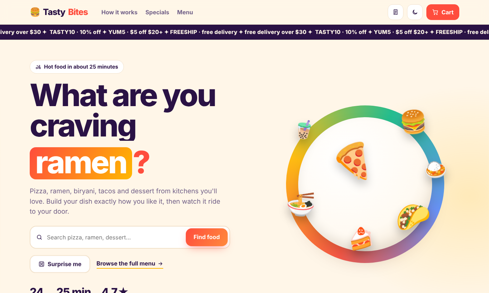
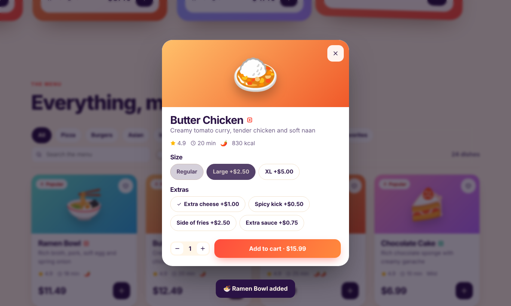
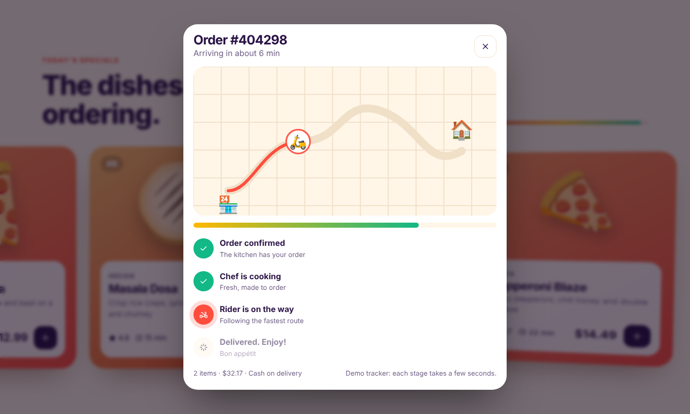

<div align="center">

# 🍔 Tasty Bites

### A playful, fully interactive food ordering website with smooth scrolling, 3D-feel animations and a live order tracker.

Browse the menu, customize your dish, check out in three steps, and watch your rider travel the map to your door.

**[🌐 Live demo](https://hemashreevi.github.io/FRONTEND_FOOD_ORDERING_SYSTEM/)** · [Features](#-features) · [Tech](#-tech-stack) · [Run it](#-run-it-locally) · [Customize](#%EF%B8%8F-customizing) · [Roadmap](#%EF%B8%8F-roadmap)




</div>

---

## ✨ Features

### A page that moves with you
- 🧈 **Buttery smooth scrolling** with Lenis, synced to GSAP ScrollTrigger
- 🍽️ **Hero plate** that spins as you scroll, with food that floats, parallaxes and leans toward your cursor
- 🔤 **Animated headline**: "What are you craving **ramen / biryani / tacos**?" (React Bits SplitText + RotatingText)
- 📣 **Promo ticker** that speeds up and skews with your scroll speed (React Bits ScrollVelocity)
- 🛵 **"How it works" scrollytelling**: the section pins while a scooter rides the road from kitchen to home
- 🎠 **Today's specials**: a pinned horizontal rail where cards swing in like a 3D carousel
- 🪄 **Fly-to-cart**: the dish leaps along an arc into your cart (GSAP MotionPath)
- 🔀 **Cards glide to new spots** when you filter or sort (GSAP Flip), with a 3D tilt on hover

### Menu
- 🍕 **24 dishes** across Pizza, Burgers, Asian, **Indian**, Mexican, **Bowls**, Desserts and Drinks
- 🔍 Live search (also from the hero), category chips and a ❤️ **Favorites** view
- 🌱 **Veg-only switch** with veg / non-veg markers, spice level, prep time, rating and calories
- ↕️ Sort by popularity, rating, price or **fastest**
- 🎲 **Surprise me** picks a random dish

### Ordering
- 🎛️ **Customizer**: size (Regular, Large, XL), extras and quantity, with the price updating live
- 🛒 **Slide-out cart** with quantity controls, delivery or pickup, a free-delivery progress bar, tips, 8% tax and promo codes
- 🧾 **3-step checkout**: address (with **saved addresses**), time (**ASAP or schedule a slot**), and pay on delivery (cash, card or UPI; no card details are ever asked for)

 

### After checkout
- 🗺️ **Live map tracker**: watch the rider move along the route while each stage lights up
- 🎉 **Food confetti** when it arrives, then **rate each dish** (your stars appear on the menu)
- 📜 **Order history** with **one-tap reorder**; progress survives a page refresh

### Quality of life
- 💾 Cart, favorites, orders, addresses and ratings persist in `localStorage` (favorites from the classic version carry over)
- 🌓 Light and dark theme, with no flash on load
- 📱 Responsive from phones to wide screens
- ⌨️ Keyboard friendly: visible focus, `Esc` closes panels, focus stays inside open dialogs
- 🐢 Respects `prefers-reduced-motion` (all scroll effects switch off)

---

## 🎟️ Promo codes

| Code | Effect |
|---|---|
| `TASTY10` | 10% off the subtotal |
| `YUM5` | $5 off orders of $20 or more |
| `FREESHIP` | Waives the delivery fee |

Delivery is also free automatically at $30 or more (after discounts) or when you choose **Pickup**.

---

## 🧰 Tech stack

| Need | Choice |
|---|---|
| UI | React 19 + Vite |
| Animation | [GSAP](https://gsap.com) with ScrollTrigger, Flip, MotionPath and SplitText via `useGSAP` (patterns from [greensock/gsap-skills](https://github.com/greensock/gsap-skills)) |
| Smooth scroll | [Lenis](https://github.com/darkroomengineering/lenis), driven by GSAP's ticker |
| Components | [React Bits](https://github.com/DavidHDev/react-bits): SplitText, RotatingText, ScrollVelocity, ShinyText, CountUp, Magnet, ClickSpark |
| Design system | Generated with [UI UX Pro Max](https://github.com/nextlevelbuilder/ui-ux-pro-max-skill): vibrant block style, funnel checkout, SVG icons for controls, 4.5:1 contrast |
| State | React context + reducer, persisted to `localStorage` |
| Food art | Emoji on gradient plates, so there are no image files to host |

The Claude Code skills used to build it (GSAP skills and UI UX Pro Max) are included in `.claude/skills/`.

---

## 🚀 Run it locally

```bash
git clone https://github.com/HemashreeVI/FRONTEND_FOOD_ORDERING_SYSTEM.git
cd FRONTEND_FOOD_ORDERING_SYSTEM
npm install
npm run dev       # http://localhost:5173/FRONTEND_FOOD_ORDERING_SYSTEM/
npm test          # pricing and promo-code unit tests
npm run build     # production build in dist/
```

The original single-file version is kept at [`public/classic/index.html`](public/classic/index.html) and is served at `/classic/` on the live site.

---

## 🗂️ Project structure

```
src/
├── App.jsx               page layout and overlay state
├── data/menu.js          dishes, categories, sizes and extras
├── lib/pricing.js        prices, promo codes, delivery fee, tax (unit tested)
├── lib/orders.js         order stages, derived from time
├── lib/fx.js             fly-to-cart, confetti, toasts
├── state/store.jsx       cart, favorites, orders, addresses, ratings
├── components/           Hero, HowItWorks, Specials, Menu, DishCard, DishModal,
│                         CartDrawer, Checkout, Tracker, Orders, Nav, Footer
└── bits/                 React Bits components
```

---

## 🛠️ Customizing

**Add a dish** in `src/data/menu.js`:

```js
{ id: 25, name: 'Chole Bhature', emoji: '🫓', category: 'Indian', price: 9.49,
  desc: 'Spiced chickpeas with fluffy fried bread', rating: 4.8, time: 18,
  veg: true, spice: 2, popular: false, kcal: 720 }
```

**Add a category**: add it to `CATEGORIES` and give it two gradient colors in `GRADIENTS`.
**Change sizes or extras**: edit `SIZES` and `EXTRAS`.
**Promo codes**: edit `PROMOS` and the discount rule in `totals()` in `src/lib/pricing.js` (and its test).
**Tracker speed**: change `STEP_MS` in `src/lib/orders.js`.
**Rebrand**: change the color variables at the top of `src/styles.css`.

---

## 🌍 Deploy

Pushing to `main` runs `.github/workflows/deploy.yml`, which tests, builds and publishes to GitHub Pages.
One-time setup: **Settings → Pages → Source → GitHub Actions**.
If you rename the repo, update `base` in `vite.config.js` (the path is case-sensitive).

---

## ⚠️ Limitations

This is a front-end demo:
- **No real payments or accounts.** Checkout never charges anything or asks for card details.
- **The tracker is simulated** (each stage takes a few seconds) and the map is illustrative.
- **Data stays in your browser** via `localStorage`.

---

## 🗺️ Roadmap

- [x] Order history page
- [x] Map-based delivery tracking (simulated)
- [x] Dish ratings (your own, saved locally)
- [x] Saved addresses
- [ ] Real dish photos
- [ ] Backend for menu and orders (Node, Firebase or Supabase)
- [ ] Payment integration (Stripe or Razorpay)
- [ ] User accounts

---

<div align="center">

Made with 🍅 and a lot of cheese by **Hemashree V I**. If you like it, give the repo a ⭐

</div>
